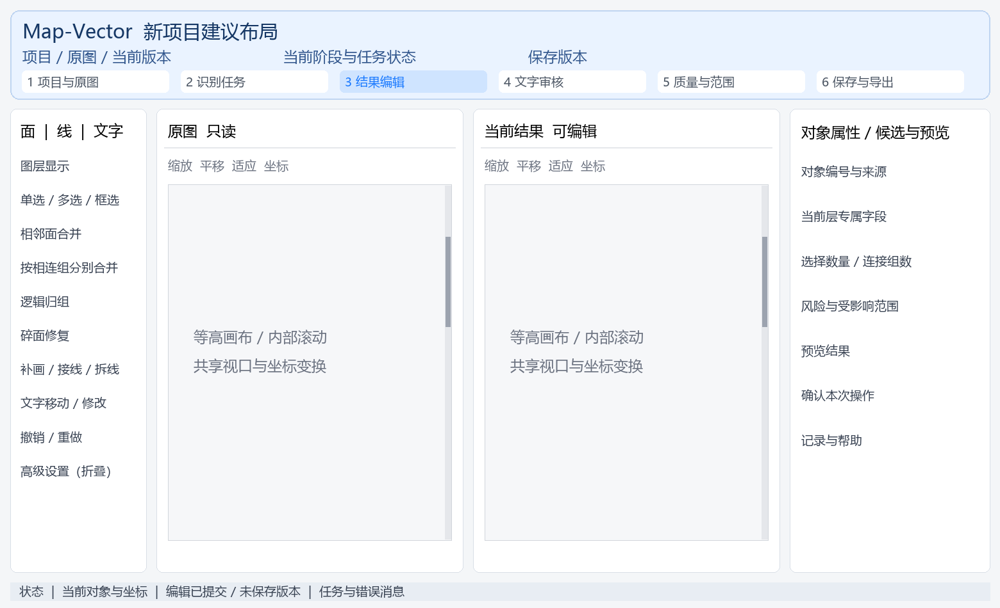

# Map-Vector 新项目迁移技术设计

编制日期 2026年11月6日　审查日期 2026年11月7日　用途：Map-Vector迁移架构、字段契约、功能对照与迁移验收。

在独立仓库承接scan2arcgis当前可运行基线，迁移B2c、PaddleOCR、RapidOCR和现有编辑能力。后端按职责组织为模块化单体；前端参考Geological-Map-Digitizer的阶段导航、卡片分区及原图与结果对照。先完成等价迁移，再单独安排算法、功能和业务规则改进。

本文件规定新项目的实现边界和验收条件。命名、数据归属、持久化和接口适配随迁移落地；识别精度、合并策略、OCR阈值及审核放行规则以冻结基线为准。已知问题进入登记表，不把原有问题登记成迁移已修复。

## 一 目标与迁移边界

首期围绕通用面、线、文字三个对象层，形成导入、识别、编辑、审核、保存和导出的完整流程。地层、道路、河流、断层等业务名称可作为未来扩展属性，不作为首期算法分类和数据库核心结构的前提。

| 迁移承接 | 迁移结构要求 | 迁移后改进 |
| --- | --- | --- |
| 现有识别、面线文字编辑、审核、残影、ROI、快照和GIS导出；逐项见附录三 | 明确职责、稳定ID、单一数据源、字段及路径一致、来源可追溯；迁移不得产生功能回退 | 精度优化、审核政策调整、交互增能、多用户、云端及新地质业务分类 |

已有能力不因迁移自动获得正确性结论。窄面恢复、碎面处理、文字补漏仍需在用户指定的真实错误位置验收。原图可辨的孔洞与独立小面不得因为追求面数量减少而被强行填掉。

新项目名称确定为 Map-Vector，Git仓库名与项目根目录名均为 Map-Vector，API统一前缀为 /api。目标目录采用 D:/software/CodeRepository/PythonProject/Map-Vector；代码通过PROJECT_ROOT解析，不在各模块硬编码绝对路径。

Python主包采用mapvector，源码位于backend/src/mapvector，导入写作import mapvector。连字符可用于仓库和文件夹名称，不能用于Python导入标识符；品牌名称与代码包名通过此固定映射对应。Python构建元信息pyproject.toml的project.name采用map-vector，前端package.json的name也采用小写map-vector，以符合各工具的包名规则。

### 强制命名约束

任何新建目录、文件名、模块名、接口路径、数据库表名、字段名和前端契约属性名都不得携带发布版本号。禁止加入v1、v2、v01、_v2、-v2、V02等版本后缀或版本目录；禁止使用日期、latest、new、old、final等词代替结构化兼容管理来复制生产入口。

| 对象 | 统一采用 | 禁止采用 |
| --- | --- | --- |
| 仓库与根目录 | Map-Vector；Python主包mapvector | Map-Vector-v2、mapvector_v02 |
| API | /api/projects、/api/projects/{project_id}/features | /api/v1/projects、/api/v2/projects |
| 目录与模块 | backend、frontend、domain、contracts、runtime | backend_v2、models/v1、api/v1 |
| 表与字段 | feature、text_attribute、text_value、fill_color | features_v2、text_v1、fill_color_v2 |
| 快照目录与接口 | snapshots/{snapshot_id}、/api/projects/{project_id}/snapshots | versions/v000001、/snapshots/v1 |
| 数据结构及算法修订 | schema_revision、pipeline_revision、mapping_revision，修订号作为字段值 | schema_v1、pipeline_v2等把编号写入字段名 |

不在路径或字段名编码版本号，并不删除数据兼容、快照历史和算法来源。修订号、发布标识、模型标识、Git提交、内容哈希及快照序号作为记录值保存；snapshot_id是稳定对象ID，working_revision是修订计数，二者都不是名称中的版本后缀。

该规则约束新项目结构和新契约。旧仓库分支名、旧文件原路径、旧字段名和第三方依赖版本只作为只读来源证据原样记录，不为美化命名而篡改历史。新设计不得再依赖这些带版本的旧路径运行。

### 单个对象与集合的命名约束

按语义命名：单个对象、单个标量和职责模块采用单数；真实集合允许且推荐自然复数。feature_id的类型为uuid，feature_ids的类型为array<uuid>；不能把数组伪装为单个feature_id，也不要求为避免复数而额外拼接_list。两种写法不得在同一语义中混用。

| 命名对象 | 约定与示例 | 选择依据 |
| --- | --- | --- |
| API资源 | /api/projects；/api/projects/{project_id}；/api/projects/{project_id}/features | projects、features表示资源集合；具体对象由路径ID定位，不另造版本段 |
| 职责与集合目录 | domain、application、geometry；adapters、repositories、tests | 前者是职责模块，后者明确容纳一组适配器、仓储或测试 |
| 前端目录 | app；pages、features、components、services、stores | 组件和页面目录是集合，允许复数；具体文件名按组件职责 |
| 项目数据目录 | models、workspaces/default/projects、snapshots/{snapshot_id}、runtime/logs | 这些目录收纳多份模型、项目、快照或日志；快照使用UUID而非发布版本编号 |
| 数据库表 | project、asset、feature、logical_group、group_member、operation | 数据库按实体统一单数；一行表示一个实体，不与API集合路径混为一套规则 |
| 单值与集合字段 | feature_id / feature_ids；warning / warnings；review_reason_codes | 单值用单数，数组和多项原因用复数，类型和含义必须一致 |
| 复合属性与范围 | source_attributes、legacy_attributes；display_bbox_px | attributes表示多个属性的映射；bbox表示一个结构化包围框，不因含四个数就改成boxes |

不机械删除单词末尾字母s：status、analysis等词本来就是单数或不可数形式。JSON Schema/OpenAPI/GeoJSON等外部标准保留字、HTTP头和第三方原接口不自行改写，例如GeoJSON的coordinates和FeatureCollection的features必须保持兼容。复数是否允许取决于是否确实表示集合，与禁止在路径或字段名加入版本号是两条独立规则。

## 二 基线与证据

本章问题来自此前本机复核。迁移验收先核对是否与冻结基线一致；新引入的丢数据、错误映射和功能缺失必须修复。原有缺陷保留编号、复现位置与影响，不以此次文档审查替代运行验证。

| 对象 | 核对基线 | 说明 |
| --- | --- | --- |
| scan2arcgis | c7b74d9c9a16d1b082f0dab694cecc8dc45363f9 | 远端验收分支 fix/stitchvector-v02-uat-remediation；本机另有未提交Windows兼容修改，必须连同清单冻结 |
| 前端参考项目 | 1a12724a6a6000a42527ffec213753e8e7c4d570 | D:/software/CodeRepository/PythonProject/Geological-Map-Digitizer；参考当前本地源码，存在本地修改 |
| 数据与验收 | docs/uat/20261106/我的复核结果.md | 已有自动、浏览器和本机真实图测试；人工结论仍待验收 |
| 现场证据 | runs/migration_design_20261106/source_evidence.json | 记录已读取核心文件的SHA-256；前端外观依据源码，未声称已完成当前运行页面的视觉核验 |

迁移基线必须同时保存 Git 提交、工作区差异补丁、未跟踪的必要源码清单、依赖版本、插件配置、模型版本和模型哈希。只检出 c7b74d9 会遗漏本机适配；只复制工作目录又无法追溯来源。虚拟环境、模型和影像不得通过 git add . 一并入库。

| 已登记情况 | 目标约束或整改方向 | 核验证据 | 处理阶段 |
| --- | --- | --- | --- |
| 手工加字、双击改字后端成功但画布未刷新 | 统一编辑响应更新前端状态和命中范围，禁止依赖刷新网页 | 输入后立即可见；后台与画布对象数量一致 | 迁移适配必检 |
| Studio预览ROI但导出仍全图 | 预览、保存、正式/草稿导出使用同一范围参数 | 设置clip后输出实际边界与ROI一致 | 原问题保留；迁移后整改 |
| 默认GBK读取OCR JSON失败 | 所有文本明确UTF-8；进程启动前设置编码 | PyCharm、脚本和命令行三入口均可加载中文 | 迁移适配必检 |
| 自动放行计入已确认导出层 | 迁移承接原可放行集合并单列审核依据；严格人工确认后续启用 | 原放行与未放行状态对账；不把可放行全称为人工确认 | 原问题保留；迁移后整改 |
| 原图1279×890与矢量826×794混用 | 导入时核验尺寸、输入哈希、run与asset绑定 | 不匹配项目被隔离，禁止直接保存覆盖 | 迁移适配必检 |
| 合并按钮含义和连接条件不清 | 三种命令分别命名、显示连接组数 | 相邻合并、分组分别合并、逻辑归组可区分 | 原问题保留；迁移后整改 |

## 三 总体架构与技术选择

采用模块化单体：一个 FastAPI API 服务负责项目会话和命令；独立子进程运行识别算法；一个 React 前端负责页面、画布与状态。先避免引入 Redis、Celery、微服务等额外部署环节。任务接口与执行器解耦，未来有实际并发需求时再替换执行器。

| 层 | 推荐技术 | 职责与限制 |
| --- | --- | --- |
| 网页 | React 18 + TypeScript 5 + Ant Design 5 + Vite 5 + Zustand 4 | 与参考前端技术系保持接近；版本在实施时用锁文件固定，不直接照搬其全部依赖 |
| 接口 | Python 3.11 + FastAPI + Pydantic 2 + Uvicorn | 类型校验、OpenAPI、统一异常、请求ID；路由不直接操作GeoDataFrame |
| 几何 | Shapely / GeoPandas / Pyogrio / Rasterio / NumPy | 先用当前实际可运行版本锁定；升级GEOS/GDAL另做回归，不与结构迁移混在一次变更中 |
| 识别 | B2c适配器；PaddleOCR独立环境；RapidOCR独立环境 | 协议保持清晰，进程隔离，模型缓存留在新项目内 |
| 工作状态 | 每项目SQLite数据库 + WKB几何 + 空间索引 | 数据、命令日志、来源与审核在同一事务中；GPKG用于算法交换、快照与导出 |
| 验证 | pytest + 浏览器端到端测试 + GIS回读 | 分别报告合成测试、真实样例、人工验收，缺样例为跳过而非通过 |

~~~text
浏览器 React
  ↓ OpenAPI接口 / 编辑命令 / 任务事件
FastAPI 路由
  ↓
应用服务 Project / Job / Edit / Review / Snapshot / Export
  ↓
领域规则与几何服务        Repository / 单写入事务
  ↓                       ↓
B2c/OCR进程适配器       每项目 project.sqlite
  ↓                       ↓
不可变运行产物          版本快照 / GeoPackage / Shapefile
~~~

API与算法适配器交换带schema_revision值的请求、结果和工件清单。算法仅读取冻结输入并写入本次run目录；编辑状态由应用服务管理。旧插件内部协议及依赖布局封装在适配层，首次迁移保留原算法输出与阈值，不在搬迁时重写识别方法。

## 四 新项目目录与依赖方向

目录名表达职责或集合；生产入口固定为mapvector。backend/src/mapvector/domain/ports定义仓储及执行器接口，application依赖这些接口，infrastructure和algorithms/adapters提供实现，避免application依赖具体SQLite或旧编辑器。contracts存放生成的契约快照；后端Pydantic模型为唯一API定义源，前端类型由OpenAPI生成。

~~~text
Map-Vector/
  backend/
    pyproject.toml
    src/mapvector/
      api/                 # routes, schemas, exception handlers
      application/         # project, job, edit, review, snapshot, export services
      domain/              # entities, enums, commands, validation, ports
      geometry/            # topology, selection, hit testing, coordinate conversion
      algorithms/
        adapters/          # b2c, paddleocr, rapidocr
        legacy_b2c/        # 已冻结的B2c依赖闭包
      infrastructure/
        repositories/      # SQLite、RTree、WKB
        storage/           # 工件、快照与原子文件写入
        workers/           # 子进程、超时、取消、重启恢复
      configuration/       # 根目录、缓存、插件配置
    tests/                 # unit, integration, contracts
  frontend/
    src/
      app/                 # routing, providers, application shell
      pages/               # import, recognition, editing, review, quality, export
      features/            # face, line, text, review, roi, project, history
      components/          # common UI + synchronized canvas panels
      services/            # generated API types + request client
      stores/              # session, entities, selection, viewport, jobs
    tests/                 # model + component + browser tests
  contracts/               # generated OpenAPI, compatibility manifest
  configs/                 # portable defaults and local example
  scripts/                 # start, diagnose, migrate, backup, restore
  docs/                    # architecture, dictionary, migration, UAT
  runtime/                 # temp, caches, logs; Git忽略
  models/                  # weights/manifests; weights不入Git
  workspaces/              # 用户项目与版本; Git忽略
  .venv/               # 新建，不复制旧虚拟环境
  # RapidOCR shares .venv
  .venv-ocr-paddle/
~~~

依赖方向：api调用application；application调用domain/geometry及domain/ports；infrastructure和algorithms/adapters实现端口并在入口装配。domain不依赖FastAPI、SQLite或旧编辑器；禁止模块顶层全局状态互相读写。

## 五 后端职责拆分与旧代码去向

| 模块 | 主要责任 | 旧代码来源 | 不允许承担的责任 |
| --- | --- | --- | --- |
| 项目与资产 | 新建、上传、标准化、原图绑定、项目选择 | studio/projects.py、inputs.py | 不直接执行合并或修改审核状态 |
| 任务与插件 | 排队、固定插件版本/哈希、进度、取消、重启恢复 | projects.py任务部分、registry.py、stage_runner.py | 不决定何时覆盖人工工作结果 |
| 面编辑 | 选择、邻接、合并、切分、碎面建议、面逻辑组 | editor/core.py的面/SelectionMixin | 不处理HTTP或输出中文通知文本 |
| 线编辑 | 补画、吸附、端点接线、拆分、分组、隔离/恢复 | core.py线编辑和角色 | 不因线分组自动改面几何 |
| 文字编辑 | 新增、内容、位置、字号角度、去重、命中计算 | core.py TextMixin、ocr_cli.py | 不将文字编辑等同于审核确认 |
| 审核 | 风险分流、确认、修改后复核、跳过、导出资格 | classify_review、review_decide | 不以几何清理状态替代人工审核 |
| 残影处理 | 文字关联残影候选、风险、面并入、线隔离 | text_preview、text_residue、text_apply | 不永久删除疑似正常线；不默认清理待定项 |
| 样式与图层 | 颜色、线宽、实虚齿形、显示和样式绑定 | legend_styles、render_lines | 不在样式更改时修改拓扑或真实宽度 |
| ROI与坐标 | 范围、内跨外统计、keep/clip计算、空间转换 | roi_report、_roi_scoped、inputs/exports | 不在前端重复实现裁剪规则 |
| 版本与历史 | 命令日志、撤销重做、保存、恢复、来源 | _snap、_do、save_as、record_version | 不使用Python对象快照作为唯一持久记录 |
| 导出与回读 | 审核门禁、坐标、格式映射、回读、清单 | studio/exports.py | 不另写一套与审核模块不一致的状态判定 |

后端先建立项目、任务、编辑、审核、范围和导出服务边界，通过适配器承接旧core.py及其依赖闭包；再逐步提取领域规则。迁移过程中每次提取均以旧输入输出对照，不要求先重写全部算法或编辑函数。

- 推荐application服务入口：upload_source、normalize_asset、start_run、adopt_run、preview_edit、apply_edit、create_snapshot、restore_snapshot、create_export。审核、样式与ROI修改同样经apply_edit进入统一事务。
- 面/线/文字修改一律通过编辑命令总线；前端不得通过不同路由绕过版本校验、撤销记录或审核策略。
- 禁止生产入口依赖 experiments 目录、临时 sys.path 插入、Path.home 下的旧项目名以及 /tmp 或 /Volumes 路径。冻结算法的必要资源随依赖闭包迁入。

## 六 数据存储与持久化原则

source_file表示一次原始上传，asset表示从该来源的指定页和标准化配置生成的图像。上传返回source_id，标准化返回asset_id；同一PDF的多页或不同DPI产生独立asset。源文件以source_id目录隔离，显示文件名不参与路径拼接。所有*_rel_path统一相对于该项目目录，使用正斜杠，解析后验证仍在项目目录内。

首期每项目一个当前编辑asset；更换资产先保存当前快照，再显式采用另一个资产的独立状态。识别run的输入资产、输入哈希和配置固定；任务状态及事件可追加更新，已提交算法产物不得覆盖。

每个项目只有一份权威工作状态：state/project.sqlite。几何以WKB存储，边界框由服务计算并维护RTree；对象属性、审核、组关系和命令变更记录在同一事务中。工作中的DataFrame和前端缓存都是派生表示，不作为第二份权威数据。

~~~text
workspaces/default/
  catalog.sqlite                     # 项目列表索引，可从项目清单重建
  projects/{project_id}/
    sources/{source_id}/              # 原始文件，只读
    assets/{asset_id}/                # 标准化图和资产清单
    runs/{run_id}/                    # 固定输入与已提交输出；事件日志追加
    state/project.sqlite             # 唯一可编辑状态，启用事务和WAL
    snapshots/{snapshot_id}/
      project.sqlite                 # 使用SQLite backup API的一致快照
      vectors.gpkg                   # 便于GIS核对的派生快照
      manifest.json                  # revision/hash/schema/source/政策
    exports/{export_id}/             # 成果、字段映射、回读报告
    migration/                       # 旧ID映射、原字段与异常报告
    project.json                     # 项目发现清单；数据库内身份为权威
~~~

保存快照使用SQLite backup API获得同一working_revision的一致副本，再从该副本生成GPKG，不能在两次读取之间混入新的编辑。工件先写同卷临时目录，校验、flush并原子改名后提交清单；快照记录schema_revision、哈希、来源和snapshot_status，未完成工件不列为可打开快照。

catalog.sqlite仅为项目发现索引，可由projects/*/project.json及项目数据库重建。快照采用prepared→files_ready→committed状态；启动时校验清单与数据库记录，登记可恢复故障，不按修改时间猜测文件，也不自动删除可能需要恢复的半成品。

新识别产物与当前工作状态分离。采用运行结果时执行revision条件检查，在事务中建立新的基线；如果已有人工编辑，界面提供保留当前、另建工作版本或明确替换，不直接覆盖。

## 七 字段统一规则

命名采用语义类型优先：feature_type、source_type、relation_type及layer_type分别表示对象类别、来源类别、来源关系类别和显示图层。相同语义复用feature_type，不另造group_kind或style_kind。layer_type允许isolated_line等派生视图，不能把它写入feature_type。

JSON作为存储编码不进入逻辑字段名：review_reason_codes为数组，config_snapshot为对象；SQLite用TEXT和json_valid校验，API直接返回JSON值，禁止二次字符串编码。geometry_wkb明确是数据库二进制编码，API使用geometry对象，不直接传Pythonbytes或DataFrame。

类型规则区分逻辑类型与落盘类型：SQLite布尔为INTEGER并CHECK IN (0,1)，API为true/false；UUID为规范小写字符串；时间为UTC RFC 3339字符串。所有浮点数必须有限，未知为null，不使用NaN/Infinity。复合主键例外为(run_id,event_id)、(group_id,feature_id)等，不能套用每行一个UUID的规则。

| 规则 | 明确要求 |
| --- | --- |
| 命名 | 数据库、API、TypeScript传输字段统一lower_snake_case；实体主键统一*_id；不再混用rgb/color/colour等同义命名 |
| 类型 | 单实体主键UUID；复合键见第九章；API布尔为true/false，SQLite受CHECK约束；数值有限；时间UTC RFC 3339 |
| 单位 | 坐标/宽度/字号使用_px；面积_px2；角度_deg；耗时_ms；尺寸width_px/height_px；质量分数score在0到1之间 |
| 空值 | 未知值用null，空集合用[]，状态用明确unknown枚举；不把空字符串、字符串None和0混当未知 |
| 枚举 | 应用状态统一lower_snake_case；Geometry的Polygon等标准类型名按几何协议保留原大小写 |
| 身份 | feature_id稳定且与行号、显示编号、逻辑组、地质类别分离；旧_eid仅进入迁移映射 |
| 坐标 | 编辑器统一asset像素坐标，x向右y向下；配准转换只在坐标服务执行；屏幕缩放不修改数据 |
| 颜色 | fill_color/stroke_color/text_color统一#RRGGBB大写六位十六进制，导入时规范化 |
| 原始证据 | OCR原文/原检测框、算法标签、输入哈希只读；编辑后的文字与显示范围另存或派生 |
| 扩展 | 确需保留无法规范化的旧字段时放legacy_attributes并登记；禁止把所有新业务随意塞进通用JSON |

新实体采用UUID4。冻结导入可用固定命名空间UUID5，根据import_id、旧工件哈希、图层和稳定旧FID生成映射；只有无稳定FID时才使用首次冻结行序。API将UUID作为字符串，不假设源显示编号可排序或跨文件唯一。所有事件序号和revision限制在JavaScript安全整数范围；超出时拒绝写入。

插件、流水线、政策注册名保持稳定，例如strict_review；修订信息放在独立记录值中，不给注册名加_v1之类后缀。配置标识不属于用户数据实体UUID；数据字典必须明确uuid与注册表string，不能把政策名塞进uuid字段。

显示编号可为F0001/L0001/T0001，仅作标签。首次导入分配稳定UUID。合并沿用旧算法：最大面存活并保留ID，其余面转为superseded历史对象；切分沿用旧算法：第一块保留源ID，新增块获新ID。feature_lineage允许source=target表达存活身份；操作前值由operation_change保存。

## 八 核心实体与关系

当前业务表使用真实外键；operation_change是追加的历史证据表，只有operation_id关联当前操作，其entity_type+entity_id是历史身份快照，目标可能已删除，因此不对当前目标建立多态外键。写入只由受控命令产生，导入和回放必须核验身份、schema_revision、依赖及前后状态；此边界不等于数据库已验证目标存在。

为组合外键建立显式UNIQUE(project_id,asset_id)、UNIQUE(project_id,run_id)、UNIQUE(project_id,asset_id,feature_id)等父键；命令幂等约束为UNIQUE(project_id,idempotency_key)，工作修订为项目内严格递增。组成员删除可物理移除，来源对象保留墓碑；撤销先恢复依赖实体，再恢复组关系和当前审核状态。

每项目SQLite启用PRAGMA foreign_keys=ON。feature(asset_id,project_id)、run(asset_id,project_id)等用复合外键保证归属；候选、组成员和样式绑定校验同项目及兼容feature_type。feature的WKB是几何真值，geometry_type、bbox、面积和长度均在同一事务派生。RTree使用独立整数rowid映射UUID；文字候选查询用display_bbox_px索引，精确命中再做旋转框校验。

专有表以feature_id为一对一主外键，服务事务保证每个对象恰有一个匹配feature_type的属性行。group_member以(group_id,feature_id)为复合主键，首期每feature至多一组。资产身份和原OCR证据不可被编辑；缺失旧来源允许null并记录legacy_unknown，不能补造运行或人工确认。

| 实体 | 主键和关系 | 用途 |
| --- | --- | --- |
| source_file / asset | source_id → asset.source_id；各自project_id | 原始上传与标准化页分别有身份 |
| project / asset | project_id → asset.project_id | 项目设置、当前工作状态；资产页面与输入证据 |
| run / job_event | run_id → asset_id；event_id → run_id | 不可变运行配置、任务状态、逐阶段事件 |
| feature | feature_id → project_id/asset_id/origin_run_id | 三类对象共性、生命周期、revision、几何和边界 |
| face_attribute / line_attribute / text_attribute | feature_id一对一关联feature | 类型专有属性；不能把文字字段写到面记录 |
| ocr_candidate | candidate_id → asset_id/run_id；可关联text_feature_id | 原始OCR证据、建议与文字对象一对多关系 |
| review | review_id → text_feature_id/text_content_revision | 每次确认针对确切内容版本，保留审核证据 |
| logical_group / group_member | group_id；group_id+feature_id复合唯一 | 面或线的逻辑分组，首期每对象最多一个同类型逻辑组 |
| style / layer_setting | style_id；layer_setting(project_id,asset_id,layer_type) | 样式与显示偏好分离，显示隐藏不等于删除 |
| feature_lineage | relation_id → source/target feature_id+operation_id | 合并、切分、恢复来源，保留原属性快照 |
| operation / operation_change | operation_id；change_id；entity_type+entity_id为历史身份快照 | 增删改的before/after数据，撤销重做与审计 |
| roi / snapshot / export | roi_id/snapshot_id/export_id | 范围修订、不可变快照、导出政策与回读报告 |
| artifact | artifact_id → run_id | 运行产物、哈希、相对路径与稳定协议名 |

feature表中的feature_type是对象类别判别字段，只取face、line、text，分别表示面、线、文字。隔离线仍然是line，使用lifecycle_status=isolated和关联记录表达；不要在恢复时重新造一个不相关的线ID。数据库按feature_type限制专有属性表和允许的几何类型，外键保证对象、run、asset属于同一项目。

数据库、API与前端传输数据统一使用feature_type及同一枚举定义。geometry_type描述实际几何结构，由geometry_wkb派生；持久化或缓存时由服务同步维护并校验。例如文字feature_type=text以Point定位。地层、道路、断层等未来业务分类独立建模。

## 九 字段字典

关键键和唯一约束：project.project_id、source_file.source_id、asset.asset_id、run.run_id、feature.feature_id、ocr_candidate.candidate_id、review.review_id、logical_group.group_id、style.style_id、roi.roi_id、snapshot.snapshot_id、export.export_id、operation.operation_id、operation_change.change_id、artifact.artifact_id、migration_import.import_id分别为主键。

job_event以(run_id,event_id)为主键；group_member以(group_id,feature_id)为主键；layer_setting以(project_id,asset_id,layer_type)为主键；migration_id_map以(import_id,legacy_file_sha256,legacy_layer_name,legacy_object_key)唯一；feature_lineage.relation_id唯一。各专有属性feature_id既是主键也是feature外键。

同名project_id/asset_id/run_id外键用组合外键保证同项目；NOT NULL只用于无条件必填项。条件必填由CHECK和事务提交前校验实现，不能直接翻译为NOT NULL。建库SQL须保证每个feature恰有一个与feature_type匹配的专有属性记录。

配套CSV为完整逻辑字段字典，本节列核心对象字段。新增枚举值、字段类型变化及默认值变化必须同步OpenAPI、迁移脚本和兼容清单。

下表给出开发时必须固定的字段。完整可筛选字典另附CSV；本节字段名称、类型和含义为统一接口的依据。主表中的project_id/asset_id通过关联传递，专有属性不重复存储整份项目元信息。

| 字段 | 类型 | 含义与约束 |
| --- | --- | --- |
| feature_id | uuid | 稳定对象ID；不可改；不使用行号 |
| project_id | uuid | 项目身份；跨项目引用拒绝 |
| asset_id | uuid | 标准化图像身份；必须与几何坐标空间一致 |
| origin_run_id | uuid／null | 产生对象的算法运行；人工对象可空；原run不可被重写 |
| feature_type | enum | 对象类别：face/line/text；数据库、API、前端同名；与专有表及允许的几何类型一致 |
| geometry_type | enum | Point/LineString/Polygon/MultiPolygon；由geometry_wkb派生并校验，禁止单独修改；文字Point；线LineString；导入多部件面可保留 |
| geometry_wkb | blob | 编辑像素坐标几何；有效性、类型、精度校验 |
| bbox_min_x_px | float64 | 几何包围框最小X；只由服务端计算 |
| bbox_min_y_px | float64 | 几何包围框最小Y；只由服务端计算 |
| bbox_max_x_px | float64 | 几何包围框最大X；不得小于最小值 |
| bbox_max_y_px | float64 | 几何包围框最大Y；不得小于最小值 |
| lifecycle_status | enum | active/isolated/deleted/superseded；删除/隔离/被合并替代分开 |
| source_type | enum | algorithm/manual/legacy_import/unknown；来源种类，不是审核状态 |
| style_id | uuid／null | 显式绑定的样式；不可跨项目错误绑定 |
| revision | int64 | 对象最近修改的工作revision；严格递增；用于并发和缓存 |
| created_at | datetime／null | 可证实的创建时间；旧数据未知保持null |
| updated_at | datetime | 最近提交时间；由事务写入 |

| 面字段 | 类型 | 含义与旧来源 |
| --- | --- | --- |
| feature_id | uuid | 对应面对象；一对一FK |
| fill_color | color | 填充色；不是地层类别 |
| algorithm_label | string／null | 原分割标签；旧整数标签转规范字符串；只读证据，新手绘面null，不伪造-1标签 |
| color_class_id | string／null | 算法调色板类别；算法调色板注册键；旧整数转字符串；不作实体外键 |
| area_px2 | float64 | 面面积；服务计算；孔洞扣除 |
| observed_area_px2 | float64／null | 原图直接观测的支持面积；不因编辑后面变大而伪造新观测 |
| inferred_area_px2 | float64／null | 原算法推断支持面积；原证据只读，不保证等于编辑后总面积 |
| coverage_status | enum | unchecked/valid/invalid；几何校验不代表识别正确 |

| 线字段 | 类型 | 含义与旧来源 |
| --- | --- | --- |
| feature_id | uuid | 对应线对象；一对一FK |
| stroke_color | color | 线颜色；与样式覆盖优先级明确 |
| stroke_width_px | float64 | 数据线宽；大于0，不与屏幕显示宽度混用 |
| line_pattern | enum | solid/dashed/teeth/unknown；导入未知不强行推为虚线 |
| line_role | enum | unknown/cover/split；控制残影风险和切面，不是业务分类 |
| length_px | float64 | 中心线长度；不包括装饰图形长度 |
| draw_order | int64 | 同层绘制顺序；稳定排序，不能用行号临时替代 |
| isolation_reason | enum／null | text_residue/misgrouped/manual等；lifecycle为isolated时需说明 |
| associated_text_feature_id | uuid／null | 残影所属文字；恢复保留关联历史 |

| 文字字段 | 类型 | 含义与约束 |
| --- | --- | --- |
| feature_id | uuid | 对应文字对象；geometry_wkb为锚点Point |
| text_value | string | 当前可见内容；去首尾空白；保留中英符号Unicode |
| original_text | string／null | OCR原始字符串；代表候选的只读副本；通过primary_candidate_id追溯，多候选原文以ocr_candidate为准 |
| font_size_px | float64 | 文字字号；必须为有限正数；范围由配置校验 |
| rotation_deg | float64 | 图像中逆时针为正；统一到[-180,180)；Canvas使用-angle |
| text_color | color | 文字颜色；与面线颜色字段规律一致 |
| text_anchor | enum | 中心锚定；首期center；导入其他值报告 |
| text_content_revision | int64 | 文字内容版本；仅实际内容改变时递增；旧明确确认依据失效，baseline_compatible同时记录本次人工改字依据 |
| review_status | enum | required/skipped/auto_accepted_unverified/confirmed/manual_edited/pipeline_complete_unverified；审核结果与review_basis联合判断；后两项承接旧状态，不等同人工确认 |
| review_reason_codes | array<string> | 需要审核的原因；受控原因码，界面翻译 |
| reviewed_content_revision | int64／null | 最近确认的内容版本；仅明确确认时填写当前内容revision；manual_edited及自动状态可null，由policy_snapshot判断放行 |
| reviewed_at | datetime／null | 明确确认时间；自动分流时间不能伪装人工确认 |
| reviewer_id | string／null | 确认操作者；自动规则用单独分类记录 |
| cleanup_status | enum | not_checked/pending/partial/complete；清理完成需记录实际影响对象 |
| display_bbox_px | array<float64>／null | 当前字形显示范围；一个[min_x,min_y,max_x,max_y]；派生缓存；不是OCR证据，不承诺精确字体度量 |
| primary_candidate_id | uuid／null | 当前采用的OCR候选；FK ocr_candidate；候选必须关联同一文字；人工文字null |
| font_family | string | 文字字体族；迁移保持原字体回退配置；记录实际字体差异，未知不冒称精确字宽 |
| review_basis | enum | 审核状态的依据；none/explicit_confirmation/manual_content_edit/automatic_rule/legacy_unknown |

项目、资产、任务、OCR候选、分组、样式、来源、操作历史、ROI、版本和导出的全部字段见配套“字段字典.csv”。其中JSON只用于真实可变的配置快照、候选数组和审计快照；关键可检索关系均有独立主外键。

## 十 旧字段迁移映射与状态拆分

每次导出固定policy_snapshot，至少包含policy_id、policy_revision、原放行状态集合和本次各状态数量。policy_revision只作为值保存；baseline_compatible引用冻结基线的实际集合，strict_review仅为迁移后可选规则。历史导入缺少确认时间或操作者时保留legacy_unknown和原放行依据，不伪造人工确认事件。

| 旧字段或表 | 目标字段或关系 | 转换规则 |
| --- | --- | --- |
| colour_faces | feature(feature_type=face)+face_attribute | 保留原几何；label→algorithm_label，colour_class→color_class_id，rgb→fill_color |
| visual_lines | feature(feature_type=line)+line_attribute | line_id仅留legacy_object_key；logical_id→logical_group + group_member；width_px→stroke_width_px |
| text_labels | feature(feature_type=text)+text_attribute+ocr_candidate | geometry为锚点；text→text_value，ocr_text→original_text；识别框与显示框分开 |
| text_residue_lines | feature(feature_type=line,lifecycle_status=isolated) | 保持原身份；解析residue_of建立关联，不能仅靠重排_eid |
| legend_styles | style | line_type dash→dashed；dash的逗号字符串转正数数组；颜色统一格式 |
| project_roi | roi | 绑定asset；不把当前viewport或整图bounds误当人工ROI |
| _eid | migration_id_map.legacy_object_key | 仅在冻结首次导入映射；绝不作为新feature_id |
| merged_from | feature_lineage+legacy_attributes | 解析eid/rgb/label/area/source/op；无法对齐历史ID则保留原文并报异常，不丢来源 |
| box_x0..box_y1 | ocr_candidate.detected_quad_px / legacy box | 先辨别是原检测框还是已编辑显示框；无法判别标记unknown，当前命中范围重新计算 |
| observed_px / inferred_px | observed_area_px2 / inferred_area_px2 | 保留原算法支持值，不随用户改色/合并冒充重新测量 |
| source | source_type+lineage+legacy source | 拆分类型和具体插件/操作，不用source描述审核或几何有效性 |

| 旧状态 | 新审核状态 | 清理/处理状态 | 迁移约束 |
| --- | --- | --- | --- |
| OCR_CANDIDATE / OCR_DRAFT / REVIEW_REQUIRED | required | 按证据映射 | 保留旧状态于legacy_attributes；正式放行仍阻断 |
| REVIEW_SKIPPED | skipped | 按证据映射 | 跳过不等于正确 |
| AUTO_ACCEPTED_UNVERIFIED | auto_accepted_unverified | 按证据映射 | baseline_compatible可放行，单列自动未核实数量 |
| OCR_CONFIRMED | confirmed或required | 按证据映射 | 确认来源可证实才confirmed；不明则报告待核验 |
| HUMAN_EDITED | manual_edited | 按证据映射 | 保持旧可放行语义，review_basis标记依据而非改称explicit_confirmation |
| TEXT_VECTOR_CREATED / BACKGROUND_CLEAR_PENDING | required | pending或not_checked | 几何流水线状态不能伪装确认 |
| TEXT_LAYER_COMPLETE | pipeline_complete_unverified | 有证据才complete | 保持旧可放行语义并单列，禁止称人工确认 |

迁移默认使用baseline_compatible政策，逐项承接冻结基线的REVIEW_DELIVERABLE集合：OCR_CONFIRMED、HUMAN_EDITED、TEXT_LAYER_COMPLETE、AUTO_ACCEPTED_UNVERIFIED可放行，其余阻断正式导出。明确确认映射confirmed/explicit_confirmation；人工改字映射manual_edited/manual_content_edit；自动放行映射auto_accepted_unverified/automatic_rule；流水线完成映射pipeline_complete_unverified/automatic_rule。这些状态须分别统计，不能把可放行都称人工确认。strict_review保留为迁移后政策，启用时另做规则验收。

## 十一 几何与编辑命令规则

历史变更使用受控entity_type与entity_id身份快照，保留已删除目标的历史。当前业务关系仍使用真实FK；导入、undo/redo回放要核对身份和依赖顺序，不把历史键宣称为当前目标外键。每次命令按旧算法完成后持久化其完整差异，严禁旧DataFrame与SQLite同时作为可写真值。

表中名称是新接口命令语义，执行调用现有算法适配器。线转面目前为experimental：旧实现会从相交邻面扣除缓冲区域并移除源线；切面可能影响沿线多个面。这些影响必须保留并在预览中说明，不将“恢复窄面”误写为只增加一块面。

只读查询与预览不增加working_revision。修改命令以project_id路径、asset_id、base_revision及idempotency_key组成统一信封；feature_ids按命令适用，新建对象允许空数组，样式等命令用对应对象ID。命令参数采用以operation_type判别的受控联合类型，禁止任意字典透传旧函数。

operation_change覆盖要素、组关系、样式、ROI和项目显示配置。原文字修改、位置修改、确认/跳过及自动分类均进入旧撤销栈，迁移继续支持撤销。撤销以带target_operation_id的补偿操作实现并递增working_revision，同时恢复之前审核状态并保留历史事件。网络重试同幂等键同摘要返回原结果，不同摘要409。

| 命令 | 允许输入 | 结果与限制 | 界面命名 |
| --- | --- | --- | --- |
| merge_adjacent_faces | 至少2个面，全部通过共享边连接 | 结果单Polygon；保持旧混合标签默认拒绝规则，用户显式允许才提交 | 合并为一个连续面 |
| merge_face_components | 一批面，可分多簇 | 每个共享边簇独立合并；孤立面保持；先显示组数和影响范围 | 按相连组分别合并 |
| group_features | 同资产的面或线，成员同类型 | 只改group_member关系；不填孔、不连间隔、不改变ID | 逻辑归组 |
| merge_multipart_faces | 首期不开放 | 可在存储层保留导入MultiPolygon；是否支持不相邻面合并作为后续明确需求 | 未启用，不能伪装成功 |
| join_lines | 目标端点、允许最大间距 | 显示连接段；虚线受保护；连接不能等同逻辑分组 | 预览接线 / 确认接线 |
| line_to_face | 手绘中心线、宽度、填色 | 沿用experimental：缓冲区域扣邻面、生成新面、移除源线；校验失败整批回滚 | 沿线宽恢复窄面 |
| split_faces | 已标记split角色的线 | 预览列出全部受影响面；不是只切当前屏幕中一块 | 沿分割线切面 |
| cleanup_text_residue | 明确文字ID、候选面组与候选线 | 待定默认不合并；风险线默认不隔离；隔离可恢复 | 预览文字残影 / 确认本次清理 |

邻接判定、容差、像素网格吸附及碎面阈值先沿用冻结基线；仅角点接触不按共享边处理。旧算法内部必要的精度网格保留并登记，不能因“禁止显示四舍五入”误删其算法步骤。显示格式化不修改数据库几何；优化邻接和容差另立改进任务。

- 预览生成preview_id、base_revision、输入对象摘要、影响对象、警告与有效期。预览后文档变化，提交返回409 PREVIEW_STALE并要求重算。
- 命令执行时再次校验，不信任前端预览。修改数据、来源关系、审核变化、操作日志和revision必须同一事务成功；失败不留部分修改。
- 撤销与重做是新的提交，working_revision仍递增；当前数据恢复到before/after，审计历史不删除。新命令发生时清空可重做分支，但保留已放弃操作记录。
- 显示隐藏只是layer_setting或view偏好；删除/忽略/隔离各有状态，保存隐藏对象时不丢已有编辑。

## 十二 坐标与渲染一致性

像素原点为图像左上外边缘，范围[0,width_px]×[0,height_px]，像素中心为(col+0.5,row+0.5)。GDAL/Rasterio仿射按[a,b,c,d,e,f]使用；PDF坐标和局部OCR框先由适配器转到同一asset坐标，禁止为显示拉伸修改坐标。

pixel模式要求crs_wkt和pixel_to_map_affine均为空；georeferenced模式二者同时有效。GPKG/SHP可保留无地理配准的像素坐标并注明单位；GeoJSON必须重投影到RFC 7946的WGS84经度纬度，像素数据输出pixel_json。SHP限制字段名长度，必须附确定的field_mapping.json；UUID、中文、null和数组转换逐项回读，数组及来源关系在关联清单保留。

编辑坐标以资产标准化图的像素边为参考，x向右、y向下。屏幕事件经同一viewport逆变换进入像素空间；原图和矢量画布共享缩放、平移和选区坐标。页面滚动、卡片内边距、devicePixelRatio都必须纳入事件换算。

~~~text
图像像素 → CSS视口： screen = panel_origin + pan + scale × pixel
CSS视口 → 图像像素： pixel = (screen - panel_origin - pan) / scale
像素 → 地图： map_x = a*x + b*y + c
               map_y = d*x + e*y + f
文字角度：图像中逆时针为正；Canvas旋转使用 -rotation_deg
~~~

文字锚点、字号、内容、字体族、角度共同决定显示与命中。迁移先保持旧字宽估算和字体回退行为，记录跨平台显示差异；编辑后同步display_bbox_px和revision。原OCR框只读，移动不能改写检测证据。精确字体度量和复杂竖排排版属于后续改进，不作为本次新增功能。

像素数据不是RFC 7946 GeoJSON。API若传GeoJSON形状的geometry对象，外层必须声明coordinate_space=pixel并定义为项目自有FeatureCollection协议；不能冒充WGS84 GeoJSON。只有有效配准数据经明确转换后才输出标准GeoJSON。

标准GeoJSON输出将对象类别写入properties.feature_type，保留顶层type=Feature与geometry.type的标准含义。feature_type是本系统应用字段，不宣称为GeoJSON强制字段；交换格式的原生字段通过适配器映射，不为统一内部命名而改写外部标准。

面积覆盖检查要声明目标：全图、ROI裁切范围或允许真实空洞的有效掩膜。合法几何不代表原图识别正确；孔洞、窄面、虚线仍要目视核验。数值容差由数据精度确定，例如面积校验使用max(1e-6,target_area×1e-12)，并记录实际计算规则。

## 十三 API契约与错误规范

编辑响应中的upserted_features必须含完整feature_type、geometry及匹配属性；removed_feature_ids只从当前视图移除，历史对象保留。非要素变更用同名集合changed_groups、changed_styles、changed_layers和roi承载；review_summary与policy_snapshot保持一致，前端不能因只刷新geometry遗漏组或审核状态。

API资源集合采用复数，URL多词片段采用kebab-case，路径参数采用完整project_id/run_id等名称；JSON字段采用snake_case，避免{id}含义随端点变化。请求类型、响应类型和错误结构均由同一OpenAPI生成前端类型；内部React回调允许onChange等生态命名，业务字段不另设camelCase别名。

geometry的JSON类型为{type,coordinates}，coordinate_space固定pixel并绑定asset_id；WKB只在SQLite和算法交换层。列表响应data.items为数组，附next_cursor与working_revision；游标绑定查询条件和revision，变化时重新获取。视口查询bbox_px=[min_x,min_y,max_x,max_y]，要素完整几何按需读取，不能把简化显示几何写回。

同源本机服务仍校验Origin和项目作用域，上传有文件大小及解码像素上限；路径由服务器按ID解析，拒绝路径穿越。长任务202仅表示受理，响应给run_id；HTTP错误统一code/message/detail/recoverable/request_id，未知异常保留日志关联ID。

统一前缀 /api，API路径不设置版本段。OpenAPI生成TypeScript传输类型，枚举只从契约生成，不在Python和TS手写两套。前端开发通过Vite代理，生产由同源服务交付静态页面；初期只绑定127.0.0.1。

接口优先兼容扩展，已有字段不改变类型和含义。首期一个受支持契约，schema_revision是响应值；确有跨系统兼容需求时再使用X-Contract-Revision请求头及兼容清单，未知修订明确拒绝。不提前维护多套接口实现，也不建立带版本号的URL、目录或字段。

| 资源 | 主要接口 | 关键约定 |
| --- | --- | --- |
| 能力与配置 | GET /api/capabilities；GET /api/plugins；GET /api/pipelines | 功能、参数、可用性、schema_revision及失败原因；前端据此显示 |
| 项目 | GET/POST /api/projects；GET /api/projects/{project_id} | 项目列表、创建及元数据 |
| 上传与资产 | POST /api/projects/{project_id}/sources；POST /api/projects/{project_id}/assets | 上传返回source_id；标准化传source_id/page_index/normalization_config，返回asset_id |
| 资产读取 | GET /api/projects/{project_id}/assets/{asset_id}；GET /api/projects/{project_id}/assets/{asset_id}/raster | 元数据、原图或缩略图；图像不塞入要素JSON |
| 运行 | GET/POST /api/projects/{project_id}/runs；GET /api/projects/{project_id}/runs/{run_id} | 识别与局部OCR共用run资源；启动202 |
| 任务控制 | POST /api/projects/{project_id}/runs/{run_id}/cancel；POST /api/projects/{project_id}/runs/{run_id}/adopt | 取消与采用各自幂等；采用校验base_revision |
| 进度与产物 | GET /api/projects/{project_id}/runs/{run_id}/events；GET /api/projects/{project_id}/runs/{run_id}/artifacts | 事件以after_event_id续读；产物哈希及相对路径登记 |
| 对象与选择 | GET /api/projects/{project_id}/features；POST /api/projects/{project_id}/selections | feature_type筛对象；layer_type筛视图；geometry/bbox_px按统一像素协议 |
| 编辑 | POST /api/projects/{project_id}/edit-previews；POST /api/projects/{project_id}/edit-commands | 统一命令，含undo/redo；提交base_revision并返回变更集 |
| 审核与候选 | GET /api/projects/{project_id}/reviews；GET /api/projects/{project_id}/ocr-candidates | 确认/跳过走编辑命令，避免第二套修改旁路 |
| 显示与样式 | GET /api/projects/{project_id}/styles；GET /api/projects/{project_id}/layers | 修改走编辑命令；集合路径不改变内部字段名 |
| 范围与质量 | GET /api/projects/{project_id}/roi；POST /api/projects/{project_id}/roi-audits；GET /api/projects/{project_id}/quality；GET /api/projects/{project_id}/rasters/{raster_type} | 设置ROI走编辑命令；quality_report为质量报告；readback_report仅指导出回读 |
| 快照 | GET/POST /api/projects/{project_id}/snapshots；POST /api/projects/{project_id}/snapshots/{snapshot_id}/restore | 创建固定revision；恢复为新操作，不替换整个历史库 |
| 导出 | GET/POST /api/projects/{project_id}/exports；GET /api/projects/{project_id}/exports/{export_id}；GET /api/projects/{project_id}/exports/{export_id}/download | 固定snapshot及ROI；下载凭ID解析 |

~~~text
编辑提交示例
{
  "operation_type": "merge_face_components",
  "asset_id": "uuid",
  "base_revision": 42,
  "feature_ids": ["uuid-a", "uuid-b"],
  "preview_id": "uuid-preview",
  "idempotency_key": "uuid-request",
  "parameters": {"allow_mixed_algorithm_labels": false}
}

成功响应
{
  "data": {
    "operation_id": "uuid-op",
    "result_revision": 43,
    "upserted_features": [],
    "removed_feature_ids": [],
    "changed_group_ids": [],
    "review_summary": {},
    "warnings": []
  },
  "request_id": "uuid-request",
  "schema_revision": "1.0"
}
~~~

| 错误码 | HTTP | 用户提示要点 |
| --- | --- | --- |
| REVISION_CONFLICT / PREVIEW_STALE | 409 | 数据已变更，保留用户选择并重新计算；不能自动重提破坏性命令 |
| FACES_NOT_EDGE_CONNECTED | 422 | 所选面分为几组；推荐“按相连组分别合并”或逻辑归组 |
| DASH_JOIN_FORBIDDEN | 422 | 虚线间隔受保护，提供逻辑归组入口 |
| ASSET_RESULT_MISMATCH | 409 | 输入尺寸或哈希不匹配，停止编辑并给出两份证据 |
| OCR_ENGINE_UNAVAILABLE / OCR_TIMEOUT | 503/504 | 标明引擎与原因，可转手工补字；不把空候选静默当成功 |
| GEOMETRY_VALIDATION_FAILED | 422 | 本次全部回滚，列出检查失败项与受影响对象 |
| FORMAL_REVIEW_INCOMPLETE | 409 | 列出未确认、跳过、自动未核实数量及当前放行政策 |
| EXPORT_SCOPE_INVALID | 422 | 缺少ROI或范围模式冲突，不默默回退整图 |
| RUNTIME_DEPENDENCY_MISSING | 503 | 缺少的解释器/模型/依赖，提供诊断入口 |

错误响应统一包含code、message、detail、recoverable、request_id；detail是一个结构化错误对象，其中多项校验错误可用errors数组。中文用户消息由前端按code翻译，日志保存英文技术异常与堆栈；不能把原始英文异常作为唯一操作说明。成功消息的“已完成”必须与后端事务提交和画布状态应用一致。

导出请求必须显式传入snapshot_id、export_format、export_mode、layer_types、scope_mode、roi_id和policy_id。scope_mode固定为full、keep_crossing、clip：full整图导出；keep_crossing丢弃域外但保留整个跨界对象；clip沿ROI实际裁切。不能用空值同时代表整图、缺少ROI和不支持裁剪。

## 十四 任务运行与进度

run记录状态、心跳、起止时间及输入配置，job_event是(run_id,event_id)追加事件。queued可直接cancelled；running经cancelling到cancelled，异常可failed；重启发现失联则interrupted。阶段日志、工件、错误和实际计数分别记录，不能凭等待时间制造百分比。

~~~text
queued → starting → running → completed
                         ↘ completed_with_warnings
                         ↘ failed / cancelling → cancelled
进程失联或服务重启：starting/running → interrupted
重试：新run，retry_of_run_id指向原run，不重写旧记录
~~~

初期一个本机执行器串行运行重型识别，避免B2c与OCR多进程无限抢占。API线程只提交任务，不等待整个算法。事件记录阶段名、实际计数、elapsed_ms、心跳、日志位置和工件；可确定分母时才给progress_percent，否则显示阶段与已等待时间。

OCR阶段是否必需由冻结pipeline配置决定。必须阶段失败则run_status=failed；可选阶段失败为completed_with_warnings，并显示未生成文字及具体原因。迁移不擅自把原来必需的OCR改成可选；合法空结果与执行失败分别报告。

取消时先终止本任务子进程树、等待退出、标记产物未完成；不终止其他用户启动的服务。Windows使用可控制的进程组，记录PID及所有权。重启时检查租约和工件清单，不能自动把旧RUNNING认作COMPLETED。

## 十五 前端参考依据与复用边界

| 参考项目源码 | 实际可借鉴内容 | 新项目对应 | 限制 |
| --- | --- | --- | --- |
| components/workflow/WorkflowStageBar.tsx | 固定顶部阶段条、当前阶段、任务摘要、进度 | AppWorkflowBar | 改为本项目五步，不照搬原六大地质业务阶段 |
| components/recognition/RecognitionStageTabs.tsx | 已到达步骤可回看、未来步骤禁用、浅蓝选中 | StageNavigation | 回看不自动回滚结果；重跑需明确失效说明 |
| components/workflow/WorkflowPageActions.tsx | 返回、结束流程、页面动作位置一致 | PageActions | 结束前处理未保存状态 |
| components/common/HeaderActionButton.tsx | 38px高、8px圆角、统一头部按钮 | ActionButton | 按操作语义分主/次/危险按钮 |
| shared/CanvasPanelSwitcher.tsx | 图层/结果模式切换、计数和状态标签 | LayerModeBar | 类别只用面/线/文字，不引入十类地质要素 |
| shared/recognitionCanvasLayout.ts | clamp(560px,74vh,860px)画布高度 | CompareCanvasLayout | 采用等高、内部滚动；小屏另有紧凑模式 |
| text/textWorkbench.css | 左右等分卡片、12px间距、900px窄屏规则 | ComparisonWorkspace | 文字旧组件本身仍有auto高度，不能不加检查直接复制 |
| index.css 与 appFeedback | 蓝白阶段卡片、统一反馈位、状态色语义 | design-tokens / FeedbackCenter | 参考项目背景为暖浅色，不简化宣称整站纯白；新项目选择中性底便于地图判断 |

该参考仓库本机有大量未提交修改。迁移前需冻结要借鉴的组件快照和来源哈希；不能把参考项目整个frontend及其backend API一起复制。复杂识别页Home和ImageRecognitionPage已经较大，应只提炼共享组件、布局和交互规律。

## 十六 新前端页面与布局

网页入口采用/projects项目列表，项目内统一/projects/{project_id}/{stage}；界面阶段为项目与原图、识别任务、编辑与审核、质量与范围、保存与导出。旧 /review 路由兼容到 /editing?mode=review；刷新后按 project_id 与模式恢复工作区。服务端持久化阶段编号保持不变，旧阶段2、3映射到界面步骤3，阶段4、5映射到步骤4、5。已有结果可直接进入编辑，审核或质量页不能把缺少OCR的合法线面工程锁死。

| 页面 | 主要字段 | 责任与动作 |
| --- | --- | --- |
| 项目与原图 | project_id、project_name、source_id、asset_id、page_index、normalization_config | 选项目、上传、页和DPI、标准化；原图与资产证据 |
| 识别任务 | pipeline_id、run_id、run_status、stage_name、progress_percent | 配置固定、启动/取消、日志、采用结果 |
| 结果编辑 | feature_id、feature_type、geometry、revision、style_id | 面/线/文字页签、选择、属性、预览、命令和来源 |
| 文字审核 | primary_candidate_id、text_value、review_status、review_basis、cleanup_status | 对照原图、候选、改字、确认、跳过和残影 |
| 质量与范围 | roi_id、revision、scope_mode、quality_report | 范围、覆盖与差异报告；不把质量指标冒充识别准确率 |
| 保存与导出 | snapshot_id、export_id、export_format、export_mode、layer_types | 保存历史、固定范围及政策、导出和回读下载 |

| 步骤 | 页面内容 | 完成条件 | 主要动作 |
| --- | --- | --- | --- |
| 1 项目与原图 | 新建、选项目、上传、页/DPI、尺寸哈希、历史结果导入 | 资产有效且与项目绑定 | 导入原图 / 下一步 |
| 2 识别任务 | B2c/OCR流程、依赖诊断、启动、进度、日志摘要 | 运行完成或明确可采用的部分结果 | 开始识别 / 取消 / 采用结果 |
| 3 编辑与审核 | 共享大画布；面线编辑 / 文字审核模式；审核队列可收起，保留筛选和视图 | 待审项可保留，内容审核、残影清理与几何命令独立记录 | 预览 / 确认编辑 / 文字确认或跳过 / 撤销重做 |
| 4 质量与范围 | 覆盖/残影摘要、ROI内跨外统计、clip/keep预览 | 校验报告完整，风险可见 | 重查 / 设置范围 / 保存版本 |
| 5 保存与导出 | 版本、草稿/正式、图层、坐标模式、ROI模式、回读结果 | 所有门禁满足，输出回读成功 | 保存版本 / 导出 / 下载 |

编辑工作区的固定区域：顶部项目与阶段栏；主区域左侧短工具栏；中间原图与结果两张等高画布；右侧属性/候选面板；底部状态条与可展开的历史/任务信息。面、线、文字使用清楚的页签，选中对象时才显示相关属性。

Geological-Map-Digitizer源码采用clamp(560px,74vh,860px)作为画布参考高度；Map-Vector使用可用视口高度减去阶段栏、工具条和状态栏计算两画布共同高度。该参考值不直接套在768px高的小屏。画布内部保留滚动/平移，标题和工具条等高，原图只读，左右共用同一个viewport。

宽屏保留约200px工具区、约280px属性区，中间原图与结果1:1分配，间距12px。可用宽度不足以保留两块各320px画布时，属性区先折为抽屉，工具区折为短栏；必要时切单画布。1366×768、1600×900、1920×1080及200%缩放分别验收，不把图像高度用于撑长页面。

图1 建议界面布局示意 根据参考项目源码提炼 非已实现界面

## 十七 前端状态与交互规范

| 状态域 | 保存内容 | 更新原则 |
| --- | --- | --- |
| project_session | project_id、asset_id、working_revision、当前保存版本 | 每个请求绑定会话；切项目取消旧请求并清空不兼容缓存 |
| feature_store | 按feature_id索引的对象、revision、加载范围 | 编辑变更集upsert/remove；不依赖重新GET整张图 |
| selection_store | 当前layer_type、选中ID、单对象定位 | 定位与批量选择分开；组高亮不自动变成全组编辑 |
| viewport_store | 缩放、平移、画布尺寸、原图/结果模式 | 双画布共享；浏览偏好不修改业务几何 |
| preview_store | preview_id、base_revision、影响对象、风险 | 文档修改后立刻标为过期，不允许旧预览重复提交 |
| review_store | 待审ID、当前项、原因、计数 | 与后端返回一致；已跳过与未核实自动项仍可筛查 |
| job_store | run_id、最后事件、阶段、取消状态 | 只接受当前run更新；旧响应不得覆盖新项目或新运行 |

- 统一编辑闭环：点击动作→提交一次命令→后端提交→应用变更集→重新计算命中/预览→重绘→显示成功。任何路径包括浮动输入、侧栏、批量审核都走同一机制。
- 把“保存工作版本”和“正式导出”分开：未审核内容可以保存工作版本，不能因要求全部审核而丢工作；正式导出必须显示政策摘要。
- 按钮规则：主操作深蓝；选中状态浅蓝；风险橙；错误红；删除等破坏性动作提供范围和数量确认。完成状态不能只靠颜色，必须有文字。
- 合并面板提交前显示：选中数量、相连组数、可合并组数、孤立数量、颜色/标签冲突。0组时给可解释原因，禁止只弹英文multipart错误。
- 所有耗时操作显示阶段、已等待时间和取消/后台运行入口；已接受任务不等于任务完成；缺乏真实进度时使用不确定进度条。
- 客户端失败保留输入和选区。断网、409冲突、超时可恢复时给重试/重算；禁止自动连续重复提交几何操作。

## 十八 图层功能迁移清单

| 对象 | 首期必须承接 | 明确限制 |
| --- | --- | --- |
| 面 | 单击/框/刷/套索；加减选；同色邻域；预览；相邻合并；分簇合并；逻辑组；碎面修复；切面；改色；来源 | 不默认将不相邻面union成一个Polygon；不以同色判断必应合并；不自动填真实空洞 |
| 线 | 单击/多选/整组；补画/吸附；接线预览；拆分/删除；组/拆组；线宽色样式；角色；隔离恢复；线转面 | 虚线不能因几何接线丢间隔；分组不改几何；渲染宽度不回写真实宽度 |
| 文字 | 整图两引擎；候选；局部OCR；补字；内容/位置/字号/角度/颜色；防重复；审核队列；残影；删除 | 局部OCR失败要说明；多候选重叠需选对象；内容编辑、审核和清理状态分开 |
| 通用 | 左右同步视图；A/B/C核验；差异图；范围审计；撤销重做；版本；草稿/正式导出 | 差异渲染若不含字形须明确标注；隐藏层不代表不保存或不导出 |

现有高级功能在新界面保留明确入口，可放折叠区但必须能找到。新增或当前缺失的能力由capabilities标记，不以按钮存在认定可用；图例契约中仅有占位而无识别实现的步骤不计作现有功能。附录三核对49个编辑操作，另列项目与任务、原图、差异图及GIS导出能力。

## 十九 迁移执行阶段与每阶段产物

| 阶段 | 执行内容 | 退出条件 |
| --- | --- | --- |
| M0 冻结基线 | 提交、本机补丁、必要未跟踪源码、配置、模型与数据哈希；冻结参考前端 | 旧工程可复现；49操作及Studio能力有清单；已知问题标记 |
| M1 项目骨架 | 职责模块、唯一入口、配置、契约生成、参考布局基础壳 | 新目录可启动；健康与依赖诊断明确 |
| M2 数据与导入 | 按字段字典建模；只读扫描、dry-run、ID映射、事务导入与回读 | 数量、属性、几何、来源对账；异常隔离 |
| M3 算法适配 | 冻结B2c与OCR插件；独立环境；运行和工件管理 | 同输入同配置输出等价；差异解释，不调精度阈值 |
| M4 编辑与页面 | 49操作逐项接入；页面归位；状态与命中同步；完整历史 | 原操作可达；输入输出与冻结行为一致；无迁移新增缺陷 |
| M5 保存与交换 | 现有审核政策、ROI模式、快照及GIS格式适配 | 旧可用路径可完成；已知旧缺陷登记；字段映射可回读 |
| M6 迁移验收 | 功能对照、性能、重启恢复、来源及回退演练 | 无遗漏、无新增回退、无数据丢失；原问题留后续清单 |

迁移完成后再建立改进计划：识别精度、严格人工确认政策、ROI原缺陷和交互增强分别验收。迁移通过表示功能承接和数据可追溯通过，不表示旧19个真实识别问题已自动解决。

## 二十 旧数据导入与异常隔离流程

~~~text
扫描项目 → 冻结源文件和哈希 → dry-run校验 → 生成ID/字段映射
  → 在目标临时目录导入 → 校验数据库与几何 → 生成差异报告
  → 用户采用新项目副本 → 写最终manifest → 旧项目保持只读
任一步失败 → rollback临时导入 → 保留错误报告 → 不覆盖旧目录
~~~

- 导入器只读旧项目。扫描project.json、原图、标准化图、run清单、working GPKG、版本、OCR候选、导出和编辑日志；每个资源都核对存在性、哈希与归属。
- 必须校验资产width/height与几何坐标范围、像素覆盖目标、run.input.raster_sha256的对应关系。此前1279×890原图配826×794结果必须报ASSET_RESULT_MISMATCH，不能靠拉伸画布或改尺寸字段强行通过。
- 相同尺寸只是必要条件之一，还须匹配run输入哈希；无法证明来源则隔离为待核验。人工恢复匹配原图时记录选择依据和哈希，不悄悄修改旧project.json。
- 旧字段列逐列映射。未知列原样保存在legacy记录；日期不明、旧状态无确认依据、组编号重复、历史来源找不到对象都输出具体异常行。
- 重复运行导入器使用source_import_key去重，不创建一批重复对象。导入工具给出对象数、总面积、图层边界、文字条数、隔离条数、分组和来源对账。
- 旧版本没有稳定ID时不能可靠重建全部命令链。保留原GPKG快照、编辑日志与哈希，以导入状态建立新可撤销基线；旧快照可只读查看，不承诺恢复旧进程未保存的内存操作。未知旧图层原样保存在导入证据工件中，须有清单，不能静默丢弃。

## 二十一 版本快照与回退策略

恢复snapshot是对当前工作状态提交restore_snapshot命令，工作revision继续递增，保留当前operation、review、snapshot及export历史；先备份当前状态，按ID恢复业务实体并登记差异。禁止用旧project.sqlite整库覆盖当前库，否则会抹掉快照之后的审计历史。跨schema恢复先执行明确的数据迁移。

迁移采用独立项目副本，旧目录在新项目通过人工验收前保留可启动状态。每个导入项目记录legacy_project_id、legacy_commit、source_import_key、源资产及工件哈希、字段映射版本和异常报告。旧系统与新系统不要同时编辑同一个GPKG。

| 风险时刻 | 恢复方式 | 禁止做法 |
| --- | --- | --- |
| 导入失败 | 删除仅属于该次导入的临时结果；保留报告，重新dry-run | 递归覆盖或删除旧runs、模型、用户原图 |
| 新版本保存中断 | 启动恢复依据prepared/files_ready/committed状态修复；不完整版本不展示 | 按修改时间猜哪个文件是最新版 |
| 新算法结果不理想 | 打开旧工作版本或拒绝采用新run结果 | 将识别失败结果自动写到working状态 |
| 新界面验收不通过 | 继续使用旧项目副本，保留新系统问题证据 | 把新数据库直接降级交给旧代码写 |
| 需要交回旧版 | 执行明确的legacy兼容导出，报告无法表达的字段 | 直接将新schema文件改名冒充旧GPKG |

## 二十二 测试与迁移验收矩阵

本章旧问题用于同图同位置对照。每项记录旧基线结果、新项目结果及差异原因；已有失败可以标记已知问题，新增回退不能通过。对算法修复效果的通过结论在迁移后单独签署。schema、ID、事务、字段映射和来源属于本轮迁移必须通过项。

| 问题编号 | 新模块检查 | 原问题复核目标 |
| --- | --- | --- |
| A01/A02/E10 | 残影候选、风险、隔离恢复、三态对照 | 原图对照字形清理正确；正常线和真实小面不误伤 |
| A05/A33 | 补画吸附、线转窄面、几何校验 | 在用户指定漏检/被吞位置恢复独立面，邻面正确；不能只用模拟缺陷 |
| A06 | 分割线预览与执行 | 恢复原分界且不误切邻面 |
| A08/A09 | 批量筛选、连接组件、几何合并与逻辑组 | 批处理可用且实际碎面/孔洞问题改善；归组不冒充几何修复 |
| A10 | 范围、内跨外统计、keep/clip导出 | 网页可选择模式；最终文件真实范围正确，不只看预览 |
| A15/A20/A24 | 端点、虚线保护、分组隔离 | 补线不接错；虚线间隔保留；同组与几何相互独立 |
| E01/E02/E12 | 审核、局部OCR、手工补漏与错误说明 | 真实错字/漏字可处理；失败原因明确；高置信度抽查 |
| E04/E09/E22 | 已有对象复用、初始字形、移动命中 | 无重复错复用，字号角度正常，新位置立即可选且样式同步 |
| E31 | 来源关系和快照 | 合并切分链可追溯，保存重开保留原属性和操作来源 |

| 补充验收域 | 必须执行的检查 |
| --- | --- |
| 契约 | Pydantic与TS类型一致；缺字段/非法枚举/空值/跨项目ID/旧revision被拒 |
| 事务与历史 | 每种命令失败回滚；撤销重做相同；网络重试幂等；恢复版本不丢来源 |
| 持久化 | 关闭服务再开、浏览器刷新、快照回读、SQLite WAL恢复均核对 |
| 输入一致性 | 不同尺寸、相同尺寸不同图、缺OCR JSON、损坏run清单均有明确处理 |
| 跨平台 | Windows PyCharm、启动脚本、命令行都UTF-8；环境与缓存路径全在新项目内；macOS/Linux布局兼容另测 |
| 界面 | 1366×768等三种尺寸；200%缩放；双画布对齐；滚动后点击坐标正确；每个入口均即时更新 |
| 导出 | 数量、几何类型/有效性、坐标/单位、关键字段/中文、审核层、来源映射、实际ROI；QGIS/ArcGIS目视 |
| 性能 | 真实全图的加载、命令、保存、导出独立计时；与旧版同机器同输入比，不把并发脚本耗时当人工操作时间 |

既有测试证据：本机一轮112项中79通过、33缺少指定U2样例跳过；浏览器24个流程22通过、2失败，另查到双击编辑刷新问题。这些是旧基线证据，不是新项目的通过结果。新项目每个阶段必须重跑对应测试；缺样例继续明确标未覆盖。

性能验收先记录当前真实图（826×794，19119面/575线/152文字）和较大图的P50/P95，再约定预算。界面应在100ms量级给出已接受反馈属于交互设计目标，不是算法完成时间承诺；实际几何/识别耗时仍由阶段状态显示。

## 二十三 Git分支与日常开发规则

新仓库以main为可发布主线，使用短期codex/功能名或团队约定前缀的分支；不为每个历史实验长期保留一套生产入口。原仓库作为只读来源remote或文档来源，不把旧工作树、所有远端分支和临时文件复制为主项目结构。

| 分支/标签 | 用途 | 合入条件 |
| --- | --- | --- |
| main | 已通过回归且可演示的主线 | 迁移阶段验收完成；数据字典和接口同步 |
| codex/migration-foundation等短期分支 | 一个明确模块或迁移阶段 | 小范围评审、自动测试、来源清单更新 |
| codex/bugfix-具体问题 | 修复可复现缺陷 | 先复现、补回归、标记关联问题ID |
| baseline-v02-c7b74d9 | 标记旧基线来源 | 同时保存本机补丁和模型配置清单，不能仅靠此tag覆盖未提交差异 |
| release-vX.Y.Z | 新项目发布版本 | 完整迁移报告、人工验收、正式输出政策和回退演练 |

- 一次提交围绕一个职责，结构重排、算法阈值调整、数据schema变化分别提交。
- 数据库schema变化必须有版本化迁移脚本和备份/兼容说明；破坏兼容时升级契约版本。
- 每个PR说明问题、变更行为、字段/接口影响、验证与局限；不能把“工具链已交付”写成所有真实错误已修复。
- LICENSE/NOTICE、模型与第三方依赖许可证逐项清点，保留原代码来源和必要声明；没有证据时不假定可随意再分发。
- 旧assets-decisions检查失败不能因新建仓库就视为消失。虚拟环境、模型权重、影像样本、个人文档均有明确忽略和资产清单策略。

## 二十四 Windows本机运行与目录管理

新项目建立新的虚拟环境，不拷贝旧.venv目录。Python虚拟环境包含绝对路径、启动器和二进制依赖，直接移动可能失效。先从当前实际环境导出版本清单，整理成API、B2c、RapidOCR、PaddleOCR分别锁定的依赖，针对Windows wheel/GDAL兼容复现。

| 用途 | 新项目相对路径 | 规则 |
| --- | --- | --- |
| API与B2c解释器 | .venv/Scripts/python.exe | 若B2c依赖与API冲突再独立环境，不无依据拆更多环境 |
| RapidOCR解释器 | .venv/Scripts/python.exe | 局部与整图识别使用同一明确配置 |
| PaddleOCR解释器 | .venv-ocr-paddle/Scripts/python.exe | 记录Paddle版本、模型哈希；Windows CPU选项独立配置 |
| OCR模型 | models/paddle、models/rapid | 权重不入Git；按模型manifest校验；优先复用可验证的本地权重副本 |
| 临时与缓存 | runtime/temp、runtime/cache | TEMP/TMP/TMPDIR及模型缓存环境变量在启动子进程前设置 |
| 工作区 | workspaces/default | 所有用户项目/版本/导出均在此；相对路径按PROJECT_ROOT解析 |
| 日志 | runtime/logs | 请求ID、项目ID、run、操作ID关联；错误日志不夹入原始数据或凭据 |
| 前端开发 | frontend/dist与Vite代理 | 开发前后端分开；生产可同源启动，用户无需手动开两个服务 |

启动器先定位自身目录获得PROJECT_ROOT，再设置PYTHONUTF8=1或使用python -X utf8启动。所有JSON/CSV/文本代码仍必须显式encoding='utf-8'，环境变量不能替代逐处修复。端口通过配置指定，建议开发API 8840、前端5175，避免覆盖旧8820/8830与参考项目5173/8000；此为建议值，启动前检查占用并明确报错。

默认不自动下载模型；缺模型时诊断页说明所需文件、目标项目内路径和校验值。任何下载、缓存和测试产物只能进入新项目配置目录，不回落到用户C盘缓存或系统/tmp。读取系统字体和已安装运行库不等于把项目数据写到系统目录。

## 二十五 关键场景的端到端合同

### 场景A 碎面合并

用户在面页签选主面→面积/颜色筛选加入选区→后端预览返回3个连接簇、2个可合并簇和1个孤立面→界面显示各簇轮廓→用户点“按相连组分别合并”→命令校验revision和邻接→事务写新面、来源和日志→响应变更集替换原对象→界面显示2组已合并、孤立面保留。任何不同标签/边界风险在提交前可见。

### 场景B 手动补字与审核

用户点“加文字”并输入→create_text命令返回新feature_id及完整对象→前端应用变更集并重绘→状态按原基线映射为manual_edited/manual_content_edit。baseline_compatible按原规则可放行，界面明确显示人工改字依据；若用户执行明确确认则记录confirmed及reviewed_content_revision。strict_review的强制二次确认在迁移后单独启用。

### 场景C ROI实际裁剪

用户框ROI→保存ROI得到revision→预览内跨外统计→固定snapshot_id及scope_mode→调用同一ScopeService和旧可用裁切能力→回读边界、数量、有效性与关联字段。旧Editor已有keep/clip，Studio导出缺口单独标记后续整改；新界面不得把只有预览能力的路径显示为已经执行实际裁切。

### 场景D 新运行结果与人工编辑并存

用户已有revision 80人工修复→提交新识别run固定输入与配置→期间继续编辑到revision 85→run完成时采用请求仍携带80→后端拒绝直接覆盖，界面显示另存新结果或保留当前工作→用户明确选择新的工作版本后再建立基线。原运行、原工作版本和人工来源均可追溯。

## 二十六 交付清单与实施检查

| 交付物 | 最低内容 | 验收方式 |
| --- | --- | --- |
| 迁移基线包 | 旧提交、本机差异、配置、字段、模型与输入哈希 | 可在旧环境重现，不包含不必要的私有数据 |
| 架构与字段文档 | 本文件、字段字典CSV、旧新映射、枚举与错误码 | 后端/前端使用同一契约 |
| 新仓库 | 明确目录、主入口、README、依赖锁、配置示例、许可证来源 | 全新环境可按步骤启动 |
| 迁移工具 | scan/dry-run/import/verify/report，幂等与隔离 | 不修改源，重复执行不重复导入 |
| 五步前端 | 参考布局、双画布、对象属性、审核、ROI、导出 | 真实浏览器点击完成全流程 |
| 测试与回归 | 单元/契约/集成/浏览器/数据回读/人工问题矩阵 | 通过、失败、跳过和人工待验分开 |
| 发布与回退资料 | 版本清单、未解决问题、数据备份、回退演练 | 能回到旧副本且无原始数据损失 |

已确认：产品、仓库和根目录Map-Vector；目标D:/software/CodeRepository/PythonProject/Map-Vector；Python主包mapvector；构建及前端包名map-vector；API /api；对象类别feature_type=face/line/text。新生产名称不带版本号，集合允许复数。迁移默认承接原功能及baseline_compatible政策，strict_review和新业务能力放在迁移后改进计划。

按M0—M6执行迁移，每阶段交付功能对照与数据核验记录。旧系统和原始数据保留独立可运行副本；新项目完成等价验收后，再安排原问题整改和功能优化。本文通过的是迁移设计审查，运行正确性由后续实现与验收证明。

## 附录一 主要源码依据

| 项目 | 已核对文件 | 用于本设计 |
| --- | --- | --- |
| scan2arcgis | tools/stitchvector_editor/core.py、server.py、static/app.js | 对象、命令、审核、全局状态与界面同步 |
| scan2arcgis | tools/stitchvector_studio/projects.py、contracts.py、inputs.py | 项目目录、任务、资产、schema与输入证据 |
| scan2arcgis | tools/stitchvector_studio/exports.py、runtime.py、plugins/* | 导出、坐标、审核门禁、Windows路径与插件环境 |
| scan2arcgis | experiments/STITCHVECTOR/sv_oracle_v2.py | 真实线面字段来源与B2c输出 |
| Geological-Map-Digitizer | frontend/package.json、App.tsx、pages/Home.tsx | 前端技术系和现有大型页面边界 |
| Geological-Map-Digitizer | WorkflowStageBar.tsx、RecognitionStageTabs.tsx、WorkflowPageActions.tsx | 阶段导航、返回/结束、状态与动作语义 |
| Geological-Map-Digitizer | recognitionCanvasLayout.ts、CanvasPanelSwitcher.tsx、textWorkbench.css、index.css | 等高画布、卡片、模式切换、样式基准 |

实际运行字段还核对了本机新识别GeoPackage：colour_faces含label/colour_class/rgb/observed_px/inferred_px/source；visual_lines含line_id/logical_id/kind/width_px/rgb/source/draw_order；text_labels含OCR原文、当前文字、字号角度、检测框、审核与模型来源。源文件清单及哈希见runs/migration_design_20261106/source_evidence.json。

## 附录二 设计一致性核对

- 工作状态唯一权威为项目SQLite；版本GPKG和GIS导出均为派生工件，未同时指定两套可编辑真值。
- 原始资产、原OCR证据和算法标签与当前编辑分开；审核、清理、生命周期和任务状态分别定义。
- 同一对象ID在加载、选取、编辑、保存、重开和导出中稳定；合并切分保留来源关系。
- 所有前端入口使用相同命令闭环与统一审核/ROI导出服务，没有只在接口层支持而网页遗漏的验收替代。
- 前端参考依据是实际本地源码，布局图为拟建示意；未把参考项目的配准融合能力承诺为本次迁移范围。
- 缺失样例、未确认真实错误和无法证明来源的旧数据保持待验/隔离，不编造通过结果。

## 附录三 现有功能迁移对照与审查结论

依据tools/stitchvector_editor/server.py当前分发逻辑核对49个编辑操作。下表按职责归类，配套功能迁移对照.csv逐项列出旧操作、新模块和页面入口；操作名为只读来源证据，新API名称通过受控命令映射。

| 功能组 | 旧操作 | 页面与承接要求 |
| --- | --- | --- |
| 选择查询 | pick、box、group、grow、select_gesture、grow_sel、shrink_sel | 结果编辑：选择工具；点选、框选、组选择、同色扩展、刷/套索及收缩扩展 |
| 外观与线组 | recolour、rewidth、regroup、ungroup_lines、isolate_lines、set_role、apply_legend、set_style | 结果编辑：属性与高级工具；改色线宽、组/拆组、隔离、角色及图例样式 |
| 线几何 | join_preview、join_lines、delete、split、draw、line_to_face | 结果编辑：线；接线、删除、拆线、补画和实验线转面；保持旧限制 |
| 面编辑 | merge、merge_preview、merge_groups、merge_history、merge_suggest、group_faces、ungroup_faces、heal_preview、heal_apply | 结果编辑：面；相邻合并、分簇、来源、建议、逻辑组与碎面刷 |
| 范围与切面 | set_roi、roi_report、roi_clip_preview、split_face_preview、split_face_apply | 质量与范围；结果编辑；ROI、审计、预览和沿SPLIT线切面 |
| 文字编辑 | text_preview、text_apply、text_residue、text_edit、text_pick、text_add、text_delete、restore_residue | 结果编辑：文字；文字审核；框选局部OCR、复用/新增、编辑、清理及恢复隔离线 |
| 审核 | review_classify、review_queue、review_decide | 文字审核；分流、队列、确认/跳过；保持旧放行语义 |
| 历史与保存 | undo、redo、save | 全局工具；保存与导出；撤销重做与版本保存；原save中的导出职责拆开 |

| Studio及通用能力 | 新职责与页面 | 承接证据 |
| --- | --- | --- |
| 项目创建、列表、上传、标准化、缩略图 | project/source/asset；项目与原图 | projects.py与inputs.py；多页、DPI、原图与哈希 |
| 插件可用性、流水线、识别、进度日志、取消、采用 | run/plugin；识别任务 | registry.py、stage_runner.py、projects.py |
| 项目打开关闭、历史版本、保存 | project/snapshot；全局与保存页 | Studio server.py及project版本记录 |
| GPKG/SHP/GeoJSON及像素JSON、回读下载 | export；保存与导出 | exports.py；外部字段映射及原审核政策 |
| 原图/当前/对照图、三种残差、叠加及阈值 | render/quality；结果编辑和质量 | editor/server.py raster接口、render.py、app.js |
| 平移缩放、图层开关、计数、同步对照 | viewport/layer；双画布 | app.js和Studio静态页面；前端入口可达 |

审查结论：已统一字段和路径命名，补齐source/asset、运行工件、历史变更、快照恢复和导出来源约束，并用现有操作逐项约束迁移范围。可据此开展M0基线冻结及新项目实现；每阶段仍须提交代码、数据回读和真实浏览器证据。前端参考为本地源码与拟建布局图，最终页面由实现后的屏幕尺寸验收确认。

标准边界：GeoJSON遵循RFC 7946，feature_type为应用属性；WKB用于几何编码，像素坐标不伪造地理CRS；SHP短字段和类型限制由导出适配及映射清单承担。术语和接口选择是项目契约，不宣称为所有商业GIS的统一强制命名。

### 2026年11月8日编辑与审核合并

工作流为项目与原图、识别任务、编辑与审核、质量与范围、保存与导出。编辑与审核以面线编辑和文字审核两种模式共用持续挂载的画布；审核队列按需加载并可折叠。文字确认、残影清理、几何编辑仍各自持久化，待审项不阻止进入下一步。旧 /review 兼容到 /editing?mode=review；原有持久化阶段 2、3 均映射为界面步骤 3，阶段 4、5 对应界面步骤 4、5，不重排数据编号。

### 2026年11月8日问题清单修复与交付

本节是此前冻结迁移范围的已授权修订。新导入、新识别使用方向、颜色、有效区域和线文字后处理；已有用户项目的原图、识别基线和历史版本不静默重写。

识别按钮同步防重入；服务端在事务内按资产、输入哈希、管线和范围复用相同活动任务。规范化应用EXIF方向、展开TIFF调色板、透明区白底合成并保留有效掩膜。GeoTIFF nodata从面线结果及质量目标区排除，真实黑色数据不按颜色删除。

导出默认推荐GPKG。Shapefile发生字段截断时明确展示损失与property_manifest.json完整值位置，不将截断后回读成功表述为无损。GeoJSON原始JSON属性精确回读，避免GDAL时间戳毫秒转换造成错误失败。兼容放行和当前内容已人工确认的严格政策分别保存，文字编辑状态不冒充人工确认。

完整文字残影清理保留蓝色待核对线和跨框线的完整几何，只清理计划中的碎面和确定短线。预览与复查采用同一候选判定，剩余保护线不算清理失败；需要移除保护线时在独立线编辑操作中核对。所属文字、审核证据、原图与框外对象保持，支持撤销重做。本条替代此前完整模式隔离框内所有蓝线的说明。

多尺度同位置同文候选融合并保留来源；不同文字或引擎读取分歧不强行合并。候选重复采用会返回现有文字ID并拒绝重复新增。已有重复文字不自动删除。

冻结B2c源代码保留。新迁移包装层保留原始基线文件，在版本化后处理中恢复漏掉的中性暗色主线、分支、虚线段；高分OCR框只抑制完整包含的暗色笔画连通块，跨框连通块保留。后端为竖排中文持久化逐字纵向layout_runs与0度旋转；上下标仍按墨迹和Unicode证据分离字号与基线。

固定960×700样本旧结果1211面、8线、16文字，新结果546面、60线、7文字，无近重合相同文字；窄面独立保留。数量变化不代表准确率，读取分歧的代号仍需审核，不能宣称所有图件和A类问题都已解决。

导入支持World与CRS文件成对提供，像元中心坐标转换为像元边缘仿射并保存证据哈希；内外配准冲突不自动覆盖。多页GeoTIFF第二页独立仿射已由用例验证。GIS交付包包含固定成果、原图与配准旁文件、排版线型/政策元数据和ArcGIS Pro验收脚本。

本机未检测到ArcGIS Pro或ArcPy，ArcGIS实机验收保持not_run。文件回读与可运行脚本不能代替实机坐标、标签、参考比例尺、旋转及虚线齿形视觉验收。实现证据和进一步验证边界以docs/migration/20261108-remediation-acceptance.md为准。
